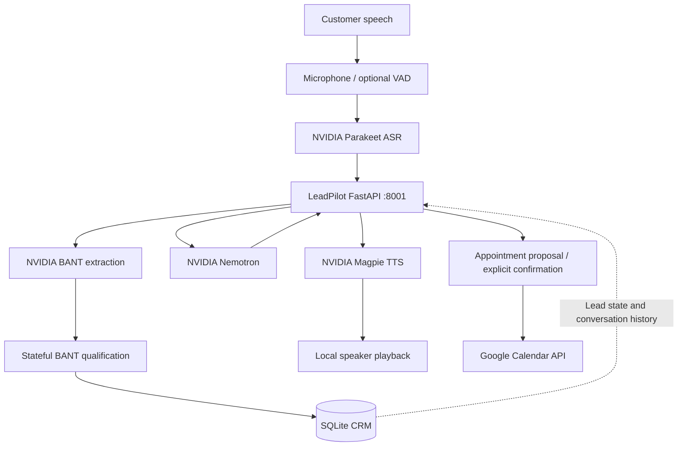
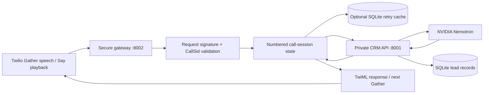

# LeadPilot AI

**NVIDIA-powered voice sales assistant for intelligent lead qualification, CRM conversations, and appointment scheduling.**

[](https://python.org) [](https://fastapi.tiangolo.com/) [](https://build.nvidia.com/) [](LICENSE) 

LeadPilot AI is a Python/FastAPI project that engages prospective customers, extracts **BANT** information (**B**udget, **A**uthority, **N**eed, **T**imeline), scores sales leads, stores CRM conversations, and supports appointment scheduling via Google Calendar. It uses **NVIDIA Nemotron** for conversations and structured information extraction, **NVIDIA Parakeet** for speech recognition, and **NVIDIA Magpie** for text-to-speech.

> **Project status:** The local NVIDIA voice demos, AI/CRM workflows, calendar workflows, and Twilio-compatible simulations have been tested. A real Twilio trial outbound call completed using **Twilio's built-in voice**, but an actual telephone call connected to NVIDIA AI has **not** yet been deployed or validated. This repository is a **portfolio MVP**, not a production telephone service.

## Table of contents

- [Key features](#key-features)
- [System architecture](#system-architecture)
- [Repository structure](#repository-structure)
- [Technology stack](#technology-stack)
- [How BANT qualification works](#how-bant-qualification-works)
- [Getting started](#getting-started)
- [Environment variables](#environment-variables)
- [Running LeadPilot AI](#running-leadpilot-ai)
- [API reference](#api-reference)
- [Google Calendar integration](#google-calendar-integration)
- [Twilio Gather fallback and reliability](#twilio-gather-fallback-and-reliability)
- [Database design](#database-design)
- [Testing and verified results](#testing-and-verified-results)
- [Security and limitations](#security-and-limitations)
- [Roadmap](#roadmap)
- [Attribution and license](#attribution-and-license)

## Key features

| Module | Implementation |
| --- | --- |
| **Conversational AI** | NVIDIA Nemotron through a configurable NVIDIA chat-completions endpoint |
| **Speech-to-text** | NVIDIA Parakeet; validates 16 kHz, mono, 16-bit PCM WAV input |
| **Text-to-speech** | NVIDIA Magpie; produces WAV responses for local voice demos |
| **Sales qualification** | NVIDIA-assisted BANT extraction and stateful 0–100 lead scoring |
| **CRM** | SQLite + SQLAlchemy for conversation history, messages and lead profiles |
| **Scheduling** | Google Calendar availability, 30-minute consultations, proposal expiry and explicit confirmation |
| **Voice interaction** | Microphone → ASR → AI/CRM → TTS → speakers, with optional voice activity detection |
| **Telephony prototype** | Twilio webhook signature validation, Gather/Say, simulated μ-law audio and WebSockets |
| **Reliability** | Numbered speech callbacks, duplicate-reply caching and optional SQLite-backed session persistence |
| **Validation** | 89 LeadPilot tests passed in the cleaned development project |

## System architecture

### NVIDIA voice and CRM workflow



The local microphone demo calls NVIDIA services directly; the CRM-enabled demos send recognized text to the private FastAPI API. **An AI conversation alone does not book an appointment**. Calendar booking is performed through separate validated endpoints after confirmation.

### Twilio speech-Gather fallback



**Audio distinction:** This Gather fallback uses **Twilio's** speech recognition and spoken `<Say>` output, whereas the local microphone demo uses **NVIDIA Parakeet and Magpie**. The current public `/twilio/voice` webhook intentionally responds with a safe announcement and hangup; it does **not** start a real NVIDIA-powered telephone conversation automatically.

## Repository structure

The following reflects the repository as published. Runtime-only files (credentials, databases and recordings) are not committed.

```text
LeadPilot-AI/
├── leadpilot_api.py                  # Main private FastAPI server (:8001)
├── leadpilot_twilio_gateway.py       # Separate signed Twilio gateway (:8002)
├── leadpilot_ai/
│   ├── __init__.py
│   ├── nvidia_llm_service.py         # Nemotron conversational LLM
│   ├── nvidia_asr_service.py         # Parakeet speech-to-text
│   ├── nvidia_tts_service.py         # Magpie text-to-speech
│   ├── lead_extraction.py            # NVIDIA-based BANT extraction
│   ├── lead_qualification.py         # Rule-based scoring
│   ├── qualification_flow.py         # BANT state merging and prompts
│   ├── conversation_api.py          # CRM conversation endpoints
│   ├── crm_store.py                  # SQLAlchemy models / database
│   ├── calendar_availability.py      # Google Calendar busy/free slots
│   ├── appointment_booking.py        # Booking preview + confirmation
│   ├── appointment_workflow.py       # Slot options for Hot leads
│   ├── appointment_confirmation.py   # Expiring proposals and confirmation
│   ├── natural_language_scheduling.py # Customer-specified date/time parsing
│   ├── voice_booking_commands.py     # Voice scheduling intent / safeguards
│   ├── twilio_stream.py              # Incoming audio packet handling
│   ├── twilio_audio_out.py           # Telephone audio encoding
│   ├── twilio_playback_local.py      # Outbound local WebSocket audio
│   ├── twilio_duplex_local.py        # Two-way local call simulation
│   ├── twilio_paced_local.py         # Pacing / interruption
│   ├── twilio_live_local.py          # Integrated local call simulator
│   ├── twilio_gather_fallback.py     # Numbered, signed Gather callbacks
│   ├── twilio_gather_store.py        # Persistent call/session SQLite store
│   └── twilio_gather_persistent.py   # Persistence adapter
├── tests/
│   ├── test_leadpilot_qualification_flow.py
│   ├── test_leadpilot_calendar.py
│   ├── test_leadpilot_booking.py
│   ├── test_leadpilot_appointment_workflow.py
│   ├── test_leadpilot_confirmation.py
│   ├── test_leadpilot_natural_scheduling.py
│   ├── test_leadpilot_voice_booking_commands.py
│   └── test_leadpilot_twilio_*.py    # Gateway, Gather, SQLite, audio tests
├── test_two_way_voice.py            # Mic -> ASR -> LLM -> TTS -> speakers
├── test_voice_with_crm.py           # Voice with CRM persistence
├── test_voice_vad_crm.py            # Voice-activity detection + CRM
├── test_voice_booking_crm.py        # Voice-assisted scheduling demo
├── test_microphone_asr.py           # Microphone ASR smoke test
├── test_nvidia.py
├── test_nvidia_tts.py
├── test_llm_to_voice.py
├── test_twilio_gather_local.py      # Offline signed Gather simulation
├── test_twilio_*_local.py           # Local Twilio audio simulators
├── connect_google_calendar.py      # OAuth authorization utility
├── static/
│   ├── dashboard.html
│   ├── login.html
│   └── voice_lab.html
├── prompts/                        # Retained prompt examples
├── config.py                       # Retained starter-era configuration
├── .env.example                    # Public placeholder configuration
├── .gitignore
├── requirements.txt
├── LICENSE
└── README.md
```

The static pages, portions of the prompts, and `config.py` are retained starter assets. They are **not represented as a fully connected, authenticated production dashboard** or the core NVIDIA service configuration.

## Technology stack

| Area | Stack |
| --- | --- |
| Language and API | Python 3.11, FastAPI, Uvicorn, Pydantic, HTTPX |
| Conversational AI | NVIDIA Nemotron |
| Speech services | NVIDIA Parakeet ASR, NVIDIA Magpie TTS |
| Microphone/audio | SoundDevice, PCM WAV, voice activity detection, Windows audio playback |
| Data | SQLite, SQLAlchemy |
| Scheduling | Google Calendar API, OAuth 2.0 |
| Telephony | Twilio, TwiML Gather/Say, μ-law audio, WebSockets |
| Testing | `unittest`, FastAPI `TestClient` |

## How BANT qualification works

NVIDIA extracts information **only from the customer's statements**, and LeadPilot preserves confirmed fields across turns. Each BANT dimension contributes a maximum of 25 points:

| Field | Supported values and points |
| --- | --- |
| **Budget** | `confirmed` 25 · `limited` 10 · `unknown` 0 |
| **Authority** | `decision_maker` 25 · `influencer` 10 · `unknown` 0 |
| **Need** | `clear` 25 · `partial` 10 · `unknown` 0 |
| **Timeline** | `within_30_days` 25 · `within_90_days` 15 · `later` 5 · `unknown` 0 |

The completed-profile categories are **Hot (≥75)**, **Warm (40–74)** and **Cold (<40)**. In the stateful conversation workflow, the category is **Incomplete** while a BANT field remains unknown. LeadPilot asks a relevant missing-field question and, once fully qualified, offers a **30-minute consultation**. Scores are rules-based indicators, not conversion-probability forecasts.

**Example:** A customer requests CRM follow-up automation, confirms an approved ₹50,000 budget, identifies themselves as the decision-maker and wants implementation within 30 days. In local integration testing, that scenario produced a **100/100 Hot** lead and **12 saved messages across six turns**.

## Getting started

### Prerequisites

- Python **3.11**, tested on Windows.
- Your own NVIDIA API key and a valid NVIDIA LLM model identifier.
- Microphone and speakers for the local voice demos; the playback code uses Windows `winsound`.
- Optional: Google Cloud Calendar API and Desktop OAuth client credentials.
- Optional: Twilio account and an HTTPS public origin for signed webhook testing.

### 1. Clone and install

```powershell
git clone https://github.com/Anujku007/LeadPilot-AI.git
cd LeadPilot-AI
python -m venv .venv
.\.venv\Scripts\Activate.ps1
python -m pip install --upgrade pip
python -m pip install -r requirements.txt
```

**Dependency note:** The current committed `requirements.txt` is a development environment freeze and omits packages imported by the application. For a fresh setup, also run:

```powershell
python -m pip install sqlalchemy google-auth-oauthlib sounddevice
```

This should eventually be consolidated into a smaller reproducible dependency file.

### 2. Set up your own credentials

```powershell
Copy-Item .env.example .env
```

Edit **your own** local `.env`. Both `NVIDIA_API_KEY` **and `NVIDIA_MODEL`** are required for NVIDIA chat. `NVIDIA_MODEL` is not yet listed in the checked-in `.env.example`, so add it yourself:

```dotenv
NVIDIA_API_KEY=YOUR_NVIDIA_API_KEY
NVIDIA_MODEL=YOUR_AVAILABLE_NVIDIA_MODEL_ID

# Optional NVIDIA service overrides
NVIDIA_BASE_URL=https://integrate.api.nvidia.com/v1
# NVIDIA_ASR_URL=
# NVIDIA_TTS_URL=

# Optional CRM SQLite URL (defaults to leadpilot_data.sqlite3)
# LEADPILOT_DATABASE_URL=

# Optional Twilio gateway
# TWILIO_ACCOUNT_SID=
# TWILIO_AUTH_TOKEN=
# TWILIO_PUBLIC_BASE_URL=https://YOUR_PUBLIC_HTTPS_ORIGIN

# Optional absolute path to persistent Gather sessions
# LEADPILOT_GATHER_DB=C:/LeadPilotPrivate/gather_sessions.sqlite3
```

## Environment variables

| Variable | Purpose |
| --- | --- |
| `NVIDIA_API_KEY` | NVIDIA LLM, ASR and TTS authentication |
| `NVIDIA_MODEL` | NVIDIA model ID for conversation and extraction |
| `NVIDIA_BASE_URL` | Optional LLM API base URL (default NVIDIA Integrate endpoint) |
| `NVIDIA_ASR_URL` / `NVIDIA_TTS_URL` | Optional speech service endpoint overrides |
| `LEADPILOT_DATABASE_URL` | SQLAlchemy URL, defaulting to local SQLite |
| `TWILIO_ACCOUNT_SID`, `TWILIO_AUTH_TOKEN` | Twilio request signature and account checks |
| `TWILIO_PUBLIC_BASE_URL` | Exact HTTPS **origin**, without a path or query |
| `LEADPILOT_GATHER_DB` | Optional **absolute path** to Gather SQLite session database |

**Never commit** `.env`, `credentials.json`, `token.json`, local databases or audio recordings. A fresh clone does not include your existing credentials or account access.

## Running LeadPilot AI

### Main private API

```powershell
python -m uvicorn leadpilot_api:app --host 127.0.0.1 --port 8001
```

- Health check: `http://127.0.0.1:8001/health`
- Interactive API docs: `http://127.0.0.1:8001/docs`

The CRM database tables are created by the SQLAlchemy model initialization. **Do not expose this API directly to the public internet**: it lacks production-grade authorization for CRM/booking operations.

### Text-based CRM conversation

In a second PowerShell terminal:

```powershell
$conversation = Invoke-RestMethod -Method Post -Uri "http://127.0.0.1:8001/api/conversations/start"
$id = $conversation.conversation_id

$body = @{ message = "We need a CRM to automate sales follow-ups." } | ConvertTo-Json
Invoke-RestMethod -Method Post -Uri "http://127.0.0.1:8001/api/conversations/$id/chat" -ContentType "application/json" -Body $body

Invoke-RestMethod -Uri "http://127.0.0.1:8001/api/conversations/$id"
```

### Local NVIDIA microphone demo

```powershell
# Direct speech -> NVIDIA ASR -> Nemotron -> NVIDIA TTS -> speaker
python test_two_way_voice.py

# Voice-activity detection + persistent CRM (main API must be running)
python test_voice_vad_crm.py
```

Audio output is generated in the local, Git-ignored `leadpilot_audio/` directory.

### Voice-assisted scheduling

```powershell
python test_voice_booking_crm.py --conversation-id YOUR_CONVERSATION_UUID
```

The voice-booking demo **does not create real bookings by default**. The optional `--allow-real-booking` flag requires additional explicit confirmation and should only be used with your own test calendar.

## API reference

These routes are served by the **main private** application on port 8001:

| Method | Endpoint | Purpose |
| --- | --- | --- |
| GET | `/health` | API health |
| POST | `/api/chat` | Direct NVIDIA chat |
| POST | `/api/leads/score` | BANT score calculation |
| POST | `/api/leads/extract` | AI-assisted BANT extraction |
| POST | `/api/conversations/start` | Create CRM conversation |
| POST | `/api/conversations/{id}/chat` | Reply, qualify and save both messages |
| GET | `/api/conversations/{id}` | Read saved messages and lead profile |
| GET | `/api/appointments/availability?date=YYYY-MM-DD` | Calendar slot lookup |
| POST | `/api/appointments/preview` | Check a slot without booking |
| POST | `/api/appointments/book` | Create explicitly confirmed booking |
| GET | `/api/conversations/{id}/appointment-options?date=YYYY-MM-DD` | Suggested slots for Hot leads |
| POST | `/api/conversations/{id}/appointment-proposal` | Create a temporary proposal |
| POST | `/api/conversations/{id}/confirm-appointment` | Confirm and book a proposal |
| POST | `/api/conversations/{id}/schedule-request` | Interpret a customer's requested date and time |

The main app also exposes local Twilio-format WebSocket development routes via its included routers.

## Google Calendar integration

1. Enable **Google Calendar API** for your own Google Cloud project.
2. Create **Desktop application OAuth credentials** and save them locally as `credentials.json` in the project root.
3. Run `python connect_google_calendar.py` to authorize. The process stores local `token.json` for future requests.
4. Availability checks read the primary calendar and return suitable free slots.
5. A **Hot lead** can request suggested slots or create a proposal; the proposal checks calendar availability but does **not** book.
6. Proposals expire after **15 minutes**. The `/confirm-appointment` endpoint requires the exact text **`CONFIRM BOOKING`** to create the calendar event.

**Scheduling policy:** Monday–Friday, **10:00–18:00 IST**, in **30-minute** increments. Booking request IDs and deterministic event IDs help handle retries. Calendar insertion uses `sendUpdates="none"`, so no invitation email is sent automatically.

The lower-level `/api/appointments/book` endpoint verifies qualification and requires `customer_confirmed=true`; the **Hot-only** constraint applies to the appointment-options/proposal workflow. These endpoints must be protected before any public deployment.

## Twilio Gather fallback and reliability

Run the **separate** gateway:

```powershell
python -m uvicorn leadpilot_twilio_gateway:app --host 127.0.0.1 --port 8002
```

| Gateway endpoint | Actual behavior |
| --- | --- |
| `GET /health` | Reports status and `live_calls_enabled: false` |
| `POST /twilio/voice` | Validates Twilio signature/account/call, says safe greeting and hangs up |
| `POST /twilio/gather-start` | Signed experimental Gather session start |
| `POST /twilio/gather-turn?step=N` | Signed, numbered speech callback |
| `WS /twilio/stream` | Validates a Twilio media stream lifecycle; not connected to live NVIDIA audio |

Numbered callback signatures, call IDs and cached TwiML responses protect **completed** turns against duplicate processing. A changed or out-of-order callback is rejected. Enabling `LEADPILOT_GATHER_DB` uses a separate SQLite store so previously completed replies can be replayed after a simulated gateway restart. Interrupted in-flight operations are treated conservatively, rather than blindly issuing another CRM request.

```powershell
# Entirely offline signed Gather conversation, using synthetic credentials
python test_twilio_gather_local.py
```

The Gather demonstration is currently limited to **six speech turns**. Its endpoints are **not automatically activated** by the safe `/twilio/voice` handler. A real NVIDIA-connected telephone conversation remains future work.

## Database design

| SQLite table | Contents |
| --- | --- |
| `lp_conversations` | Conversation IDs and timestamps |
| `lp_messages` | Customer and assistant messages |
| `lp_leads` | BANT values, lead score and category |
| `lp_appointments` | Booking request IDs, calendar event IDs and times |
| `lp_appointment_proposals` | Proposed time slots and expiry |

An optional *separate* Gather database contains `gather_sessions` and `gather_responses`, including step numbers, hashed speech, cached TwiML and session state. These databases are private runtime data and should not be committed.

## Testing and verified results

```powershell
# All published LeadPilot automated tests
python -m unittest discover -s tests -p "test_leadpilot_*.py" -q

# Twilio-focused subset
python -m unittest discover -s tests -p "test_leadpilot_twilio_*.py" -v

# Offline signed Twilio Gather simulator
python test_twilio_gather_local.py
```

**Results observed locally in November 2026:**

| Verification | Observed result |
| --- | --- |
| Cleaned LeadPilot automated suite | **89 tests passed** |
| Twilio-focused tests (subset) | **54 tests passed** |
| Real NVIDIA synthetic six-turn Gather flow | **12 saved CRM messages**, **100/100 Hot** lead |
| Duplicate NVIDIA callback test | Cached reply reused; no duplicated CRM turn |
| Persistent Gather restart simulation | Session recovery, cached replay and closed-call protection passed |
| Real Twilio outbound trial call | Completed, **25 seconds**, with **Twilio-provided audio only** |
| Local ASR/LLM/TTS and CRM voice scripts | Exercised successfully during development |

These results describe the development environment; they are **not a claim of hosted CI, production load testing, or NVIDIA-connected public telephone calls**.

## Security and limitations

- Keep `.env`, OAuth files, generated audio and local CRM/Gather databases **out of Git**.
- Twilio webhook paths validate signatures and call identity. The **main private CRM API is not authenticated for internet exposure**.
- Completed-response replay survives restart **only when the optional SQLite Gather store is enabled**.
- An uncertain or interrupted in-flight external operation may remain pending. Exactly-once effects across every external provider are **not guaranteed**.
- The Gather demo has a six-turn limit; real-call session management needs further hardening.
- Local audio playback uses Windows-specific functionality.
- Static HTML files and retained starter prompts are **not a fully integrated production dashboard**.
- Real-time Media Streams ↔ NVIDIA live-call audio is **not deployed**.
- A model's conversational promise does not constitute an actual email, calendar event or booking.

## Roadmap

- [x] NVIDIA Nemotron, Parakeet and Magpie integrations
- [x] BANT extraction, score calculation and persistent CRM
- [x] Calendar availability, proposals and explicit booking workflow
- [x] Local voice demos and Twilio media-stream simulations
- [x] Secure Twilio Gather fallback with duplicate protection
- [x] SQLite-based replay across simulated restarts
- [x] 89 passing local LeadPilot tests
- [ ] Real NVIDIA-powered end-to-end telephone call validation
- [ ] Production authorization, monitoring, recovery and deployment hardening
- [ ] Minimal reproducible dependency file and CI
- [ ] Fully integrated authenticated CRM dashboard

## Attribution and license

**LeadPilot AI** is developed and maintained in **[Anujku007/LeadPilot-AI](https://github.com/Anujku007/LeadPilot-AI)**. Its focus is NVIDIA-powered voice interaction, lead qualification, CRM persistence, appointment workflows and secure Twilio prototype integration.

Initial scaffolding and some retained assets originated from [Starter Agent — Inbound/Outbound Twilio Speech Assistant](https://github.com/aymalkhalid/Starter-Agent-InBound-OutBound-Twilio-Speech-Assistant-OpenAi-Realtime-Api-Python). This README is written specifically for **LeadPilot AI**, not as a description of the upstream project. The original attribution in the repository's existing [MIT LICENSE](LICENSE) is retained and must not be removed.

---

**Maintainer:** [@Anujku007](https://github.com/Anujku007) · **Repository:** [LeadPilot-AI](https://github.com/Anujku007/LeadPilot-AI)
