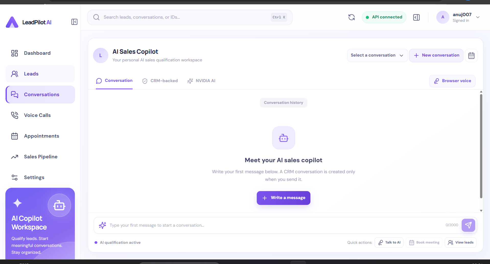
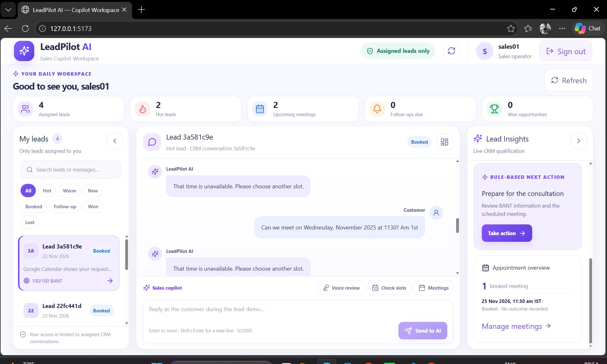
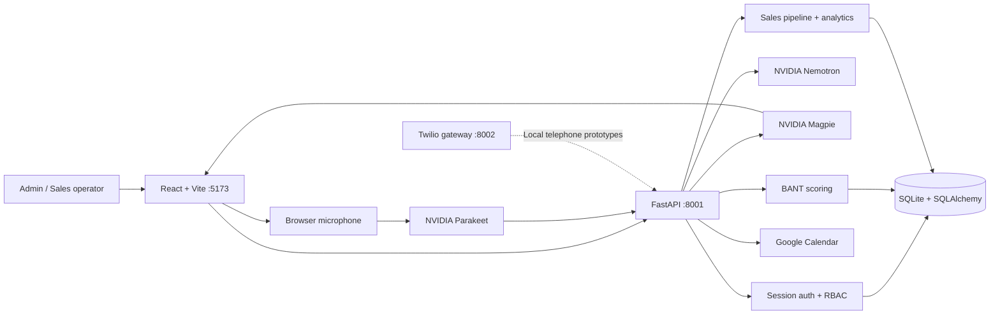

<div align="center">

# LeadPilot AI

### Student-Led AI/ML Project | Full-Stack Sales Automation Platform

**An end-to-end AI sales copilot I developed as a personal software and AI/ML project, combining voice conversations, lead qualification, CRM, calendar scheduling, and sales operations.**

[](https://python.org) [](https://fastapi.tiangolo.com/) [](https://react.dev/) [](https://build.nvidia.com/) 

[Project Story](#project-story) · [My Contributions](#what-i-built-and-integrated) · [Features](#features) · [Architecture](#architecture) · [Live Demo](#demo-flow) · [Setup](#quick-start-windows)

</div>

> **Status:** Working **local portfolio MVP**, not a production-hosted SaaS. Browser voice (NVIDIA Parakeet → Nemotron → Magpie), CRM qualification, Google Calendar booking, role-restricted salesperson views, and post-meeting sales tracking have been tested locally. A live telephone call powered end-to-end by NVIDIA AI is **not** deployed. Business conversion figures shown in demo screenshots are illustrative, not realized payment revenue.

## Project story

I developed **LeadPilot AI** as a personal AI/ML and full-stack software project to explore a practical problem: sales teams spend too much time qualifying inquiries, repeating questions, scheduling meetings, and manually tracking customer follow-ups.

My project demonstrates how a conversational AI application can turn a customer inquiry into a structured sales opportunity. It combines **NVIDIA Nemotron**, **Parakeet**, and **Magpie** with a CRM, a deterministic BANT qualification engine, real appointment scheduling, and a salesperson workspace. I designed the experience around two roles: an **admin** who oversees leads and team assignments, and a **salesperson** who works only with assigned leads.

**My goal:** build and test an integrated working prototype, not just a standalone chatbot. The system demonstrates voice-to-text, contextual conversation, BANT scoring, appointment confirmation, and post-meeting outcomes in one application.

## What I built and integrated

This is the engineering work represented by my current LeadPilot AI implementation. It includes original application development, adaptation of existing components, and integration of third-party libraries and AI services; it does **not** claim every dependency or starter file was created from scratch.

| Area | Work in my LeadPilot AI implementation |
| --- | --- |
| **Product workflow** | Designed the inquiry → BANT → qualified lead → appointment → meeting → Follow-up / Won / Lost journey. |
| **AI/ML integration** | Connected NVIDIA language, speech recognition, and text-to-speech functionality to customer-facing conversations. |
| **Conversation experience** | Built a ChatGPT-style workflow with persistent CRM history and first-message creation, plus improved non-repetitive qualification prompts. |
| **CRM and scoring** | Connected conversation storage, structured BANT extraction, deterministic scoring, lead insights and labels. |
| **Scheduling** | Integrated Google Calendar availability with explicit, auditable appointment proposals and booking confirmation. |
| **Sales operations** | Added opportunity deduplication, meeting notes, follow-up tracking, outcomes and sales analytics. |
| **Account security** | Added local admin and salesperson accounts with backend-enforced role and assigned-lead restrictions. |
| **UI/UX** | Developed admin and salesperson React workspaces, responsive panels, voice review, and visual scheduling interactions. |
| **Testing and release** | Ran isolated Python regression tests, frontend builds, and staged-file security checks to prepare a reproducible local portfolio demo. |

### Example use case

A fictional marketing agency owner needs a CRM within three weeks and has an approved budget. The customer speaks to LeadPilot AI, which transcribes and analyzes the inquiry, extracts **Budget / Authority / Need / Timeline**, and classifies the lead. The customer chooses an available consultation slot and explicitly confirms the booking. An assigned salesperson later uses the saved requirements to conduct a product demonstration and records the meeting outcome. Analytics count the lead as **one opportunity**, even if there are multiple meetings.

**Observed local verification (November 2026):** 150 Python tests passed and the React production build succeeded. Browser voice, CRM, and calendar flows were demonstrated locally. This is a tested **portfolio MVP**, not a claim of a production-ready SaaS or live NVIDIA-powered telephone system.

For a presentation-ready problem statement, workflow narrative, and demo script, see [Project Presentation Notes](docs/PROJECT_PRESENTATION.md).

## Screenshots

The images below show **demonstration data**. Review them before publishing the repository; remove screenshots containing real customer data or private identifiers.

| Admin: AI conversation workspace | Sales operator: assigned leads and insights |
|:--:|:--:|
|  |  |

## The problem

Sales teams lose time on repetitive prospect qualification, missed follow-ups, scattered conversation notes, and calendar coordination. LeadPilot AI combines those steps into a single workflow while preserving control of real-world actions such as meeting confirmation and deal outcomes.

## Features

| Module | What it does |
| --- | --- |
| **AI conversations** | CRM-backed multi-turn NVIDIA Nemotron chat; a new chat is saved only after the first submitted message. |
| **Voice copilot** | Browser recording, local playback/review, NVIDIA Parakeet transcription, editable transcript, Nemotron reply, and NVIDIA Magpie speech playback. |
| **BANT qualification** | Extracts Budget, Authority, Need, and Timeline; calculates deterministic lead score and classification. |
| **CRM** | SQLite/SQLAlchemy conversation history, lead profiles, names, and appointments. |
| **Google Calendar** | Live free/busy checking, 30-minute IST appointment proposals, separate explicit booking confirmation. |
| **Sales pipeline** | Mark actual meetings completed; save notes; record Follow-up Required, Won, or Lost. |
| **Opportunity deduplication** | Multiple meetings in one CRM conversation count as **one sales opportunity**, preventing double-counted Won value. |
| **Sales analytics** | Meetings, win rate, agreed deal value, due/upcoming reminders, and conversion indicators. |
| **Local authentication** | Admin and Sales roles with hashed passwords, HTTP-only sessions, logout, and enforced backend authorization. |
| **Assigned-lead workspace** | Salespeople access only explicitly assigned conversations, appointments, and outcomes. |
| **Telephony prototype** | Separate Twilio-compatible signed webhook/simulation gateway; not a production NVIDIA-connected telephone agent. |

## Architecture



**Security boundary:** the main API is private and designed to run on `127.0.0.1` in development. Session permissions are enforced by FastAPI, not merely hidden UI elements. The separate telephony gateway has its own security model and must not be treated as automatically covered by CRM login.

## How it works

1. A prospect sends a message or records a voice response. Voice can be reviewed and its transcript corrected before sending.
2. NVIDIA assists with extracting BANT information from customer statements and generating an appropriate response.
3. LeadPilot stores the conversation and scores BANT using application-defined rules.
4. A qualified lead can request a sales consultation. The app checks Google Calendar availability and shows an **unbooked proposal**.
5. Only a separately confirmed booking creates the actual Google Calendar event and CRM appointment.
6. Sales staff can review assigned leads and appointments, record meeting notes **after the scheduled meeting**, and select Follow-up / Won / Lost.
7. Analytics aggregates **one opportunity per conversation**. Follow-up alerts are in-app/browser-only while the workspace is open.

### BANT scoring

| Field | Values / points |
| --- | --- |
| Budget | Confirmed **25**, limited **10**, unknown **0** |
| Authority | Decision maker **25**, influencer **10**, unknown **0** |
| Need | Clear **25**, partial **10**, unknown **0** |
| Timeline | Within 30 days **25**, within 90 days **15**, later **5**, unknown **0** |

Lead categories: **Incomplete** if required details are unknown; otherwise **Hot ≥75**, **Warm 40–74**, **Cold <40**. Scores are structured qualification signals, not calibrated purchase probabilities.

## Technology

- **Frontend:** React, Vite, Tailwind CSS, Lucide icons
- **Backend:** Python, FastAPI, Pydantic, HTTPX, Uvicorn
- **AI:** NVIDIA Nemotron (LLM), Parakeet (speech-to-text), Magpie (text-to-speech)
- **Data:** SQLite, SQLAlchemy
- **Integrations:** Google Calendar OAuth 2.0; separate optional Twilio integration prototype
- **Quality:** Python `unittest`, frontend Vite production build, isolated authorization checks

## Quick start (Windows)

**Requirements:** Python 3.11 with the backend dependencies, Node.js/npm, a valid NVIDIA API key + model, and optional Google Calendar credentials. Run local commands from the repository root.

```powershell
# First clone or open your working repository
# git clone https://github.com/Anujku007/LeadPilot-AI.git
cd D:\LeadPilot_AI

# Use your own Python environment; shown path is a local development example
& "C:\Anaconda3\envs\venv\python.exe" -m pip install -r requirements.txt

# Place local secrets in .env (never commit it); see Environment below
# Start the API
& "C:\Anaconda3\envs\venv\python.exe" -m uvicorn leadpilot_api:app --host 127.0.0.1 --port 8001
```

In a **second terminal**:

```powershell
cd D:\LeadPilot_AI\frontend
npm ci   # npm install if no package-lock.json exists
npm run dev
```

Open **http://127.0.0.1:5173**. Vite proxies `/api` to the FastAPI backend. For a separate local telephony prototype, see `leadpilot_twilio_gateway.py`; it is **not** required for the browser chat or CRM.

### Environment

Create a local `.env` based on `.env.example`. Never commit real credentials.

```ini
NVIDIA_API_KEY=<your-own-key>
NVIDIA_MODEL=<your-enabled-nvidia-model-id>
# Optional: NVIDIA_BASE_URL=https://integrate.api.nvidia.com/v1
# Optional: LEADPILOT_DATABASE_URL=sqlite:///.../private-data.sqlite3
# For later HTTPS hosting only: LP_AUTH_COOKIE_SECURE=true
# For later hosting only: LP_AUTH_ORIGINS=https://your-frontend.example
```

Google Calendar uses locally authorized `credentials.json` and `token.json`, created through `connect_google_calendar.py`. They are private. A deployment requires separate, server-safe OAuth token handling; do not upload local OAuth secrets to a public repository.

### Create the first admin operator

```powershell
cd D:\LeadPilot_AI
& "C:\Anaconda3\envs\venv\python.exe" scripts\create_leadpilot_admin.py
```

Enter a username without spaces and a strong password (12–128 characters); password entry is hidden. Sign in through the frontend. From the admin account menu, use **Manage team & assignments** to create Sales accounts and assign specific CRM leads. Staff cannot browse unassigned leads or unrestricted admin dashboards.

### Useful endpoints

| Endpoint | Purpose | Security |
| --- | --- | --- |
| `GET /health` | Local health check | Public health indicator |
| `POST /api/auth/login` | Sign in | Public login |
| `GET /api/dashboard/summary` | Admin summary | Requires authenticated admin |
| `POST /api/conversations/start` | Initialize a CRM chat | Authorized session |
| `POST /api/conversations/{id}/chat` | Reply through NVIDIA and update BANT | Authorized lead scope |
| `GET /api/appointments/availability?date=YYYY-MM-DD` | Calendar slot availability | Authenticated/authorized |
| `GET /api/sales/pipeline` | Pipeline records and outcomes | Authorized scope |

Admin and salesperson views rely on additional role-restricted `/api/team/` and scheduling endpoints. See the source for exact request schemas; endpoint visibility does not imply permission to access arbitrary leads.

## Demo flow

Use **fictional** customer data. A demo customer might need CRM follow-up automation, have an approved ₹70,000 budget, be the company owner, and need implementation within three weeks. Speak the answers via the browser microphone or type them, verify the BANT score, then **check a calendar proposal without confirming an unwanted real booking**. With a completed *test* meeting, demonstrate Follow-up → Won/Lost and verify one counted opportunity regardless of the number of meetings.

## Testing

Run with the local Python environment and Node.js configured:

```powershell
cd D:\LeadPilot_AI
& "C:\Anaconda3\envs\venv\python.exe" -m unittest discover -s tests -p "test_leadpilot_*.py" -q
& "C:\Anaconda3\envs\venv\python.exe" -m unittest discover -s tests -p test_leadpilot_auth.py -q
& "C:\Anaconda3\envs\venv\python.exe" -m unittest discover -s tests -p test_leadpilot_team_access.py -q
cd frontend
npm run build
```

The authorization/role-based tests and the React production build passed during the latest installed upgrades. Earlier full suites passed before later auth changes; **do not assume the current complete suite passes until rerun**. For release procedures and sensitive-file checks, see [`docs/RELEASE_CHECKLIST.md`](docs/RELEASE_CHECKLIST.md).

## Security and limitations

- Keep the FastAPI service, Vite dev server, and optional Twilio gateway on **localhost** until deployment hardening is complete.
- Accounts share a local CRM; assigned-lead restrictions are **not** full multi-tenant SaaS isolation.
- Browser recording requires microphone permission. Review and send audio deliberately; do not record people without consent.
- Live real-time NVIDIA-powered Twilio telephone conversations have **not** been validated or deployed.
- A proposed appointment is **not** a booking. Booking requires explicit confirmation and a successful calendar API result.
- Browser follow-up notifications only run while the workspace is open. No automatic email/SMS reminders are implemented.
- Won value means **agreed deal amount**, not actual collected payments.
- Authentication is a development MVP; production requires HTTPS, secure cookies, origin/CSRF review, external session handling, monitoring, data retention, backups, and a full access-control audit. See [`docs/DEPLOYMENT_READINESS.md`](docs/DEPLOYMENT_READINESS.md).

## Roadmap

- Hosting and environment separation with secure HTTPS reverse proxy and persistent storage
- Production-grade secrets/session management, backup/restore and monitoring
- Additional salesperson permissions, lead assignment history and audit reporting
- Optional email reminders (only after explicit consent and configuration)
- Actual NVIDIA-connected telephone calling after telephony safety and reliability testing

## Project ownership, acknowledgments and license

**LeadPilot AI project developer and maintainer:** [@Anujku007](https://github.com/Anujku007). I led the development and integration of the current AI-powered sales workflow and the connected frontend/backend features described above.

This project was developed iteratively using open-source software and developer tooling. **Initial scaffolding and some legacy Twilio-oriented components** were adapted from [Starter Agent — Inbound/Outbound Twilio Speech Assistant](https://github.com/aymalkhalid/Starter-Agent-InBound-OutBound-Twilio-Speech-Assistant-OpenAi-Realtime-Api-Python). The [existing MIT LICENSE](LICENSE), including its original copyright notice, is retained. That credit does not change the distinction between upstream starter components and my LeadPilot AI extensions.

Third-party dependencies, AI models, external APIs and assets remain subject to their own terms. Use your own NVIDIA, Google and Twilio credentials; never commit keys, tokens, or customer databases.
